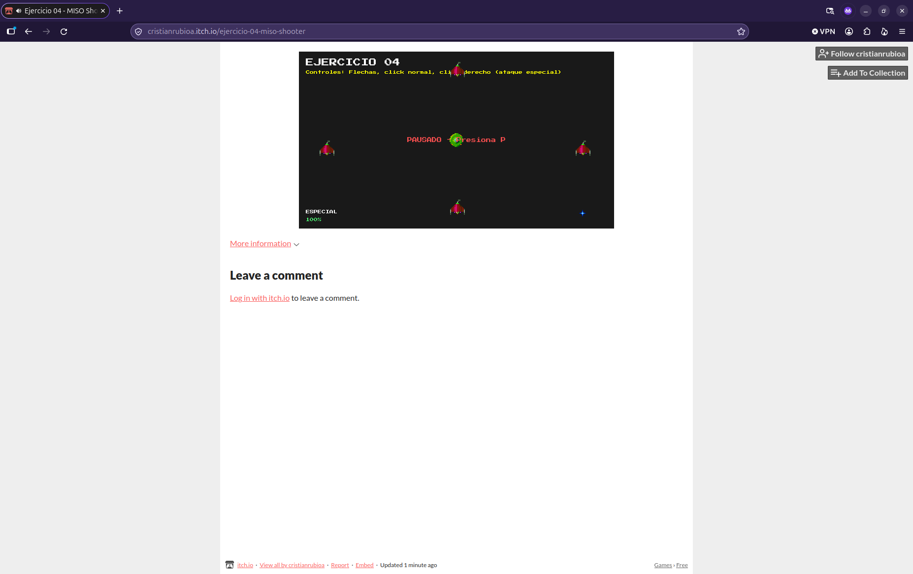

# Intro Video Games


[](https://cristianrubioa.itch.io/ejercicio-04-miso-shooter)

Proyecto de la serie "Introducción al desarrollo de videojuegos con ECS" (MISW-4407).



**Jugar:** https://cristianrubioa.itch.io/ejercicio-04-miso-shooter

## Requisitos

- Python 3.12.2
- [Poetry](https://python-poetry.org/)

## Instalación

```bash
poetry install
```

## Ejecución

```bash
poetry run python main.py
```
